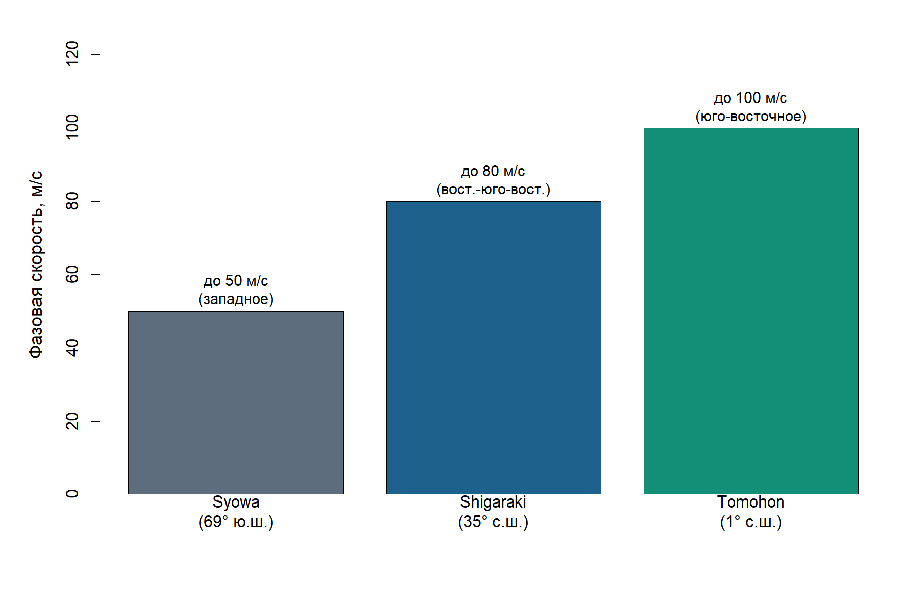

```{r setup, include=FALSE}
knitr::opts_chunk$set(echo = TRUE, fig.align = "center",
                      fig.width = 8, fig.height = 4.5)
# Для корректного отображения кириллицы на графиках в PDF используется cairo_pdf
if (knitr::is_latex_output()) {
  knitr::opts_chunk$set(dev = "cairo_pdf")
}
if (!dir.exists("figures")) dir.create("figures")
# Ссылка на репозиторий проекта на GitHub (создан в лабораторной работе 4.2)
github_url <- "https://github.com/AnasDol/isu3_data_cleaning_r"
```

# Введение

Лабораторная работа выполнена в рамках курса «Очистка данных» (ИГУ, DOMIC) и посвящена двум темам: видам анализа данных и языку разметки R Markdown. В соответствии с моим вариантом из лабораторной работы «Виды анализа данных» рассматриваются **дескриптивный** и **причинно-следственный** виды анализа. Для каждого из них выбрана научная статья с примером реального исследования атмосферы, и принадлежность статьи к соответствующему виду анализа обоснована ниже.

Обоснования оформлены в виде документа R Markdown, содержащего все обязательные элементы разметки: заголовки разных уровней, маркированные и нумерованные списки, URL-ссылки, математические формулы LaTeX, изображения, цитаты и таблицы. Документ скомпилирован в два формата — PDF и HTML. Исходные файлы работы (.Rmd, .pdf, .html) опубликованы в [репозитории проекта на GitHub](`r github_url`).

Задачи работы:

1. охарактеризовать дескриптивный и причинно-следственный виды анализа данных;
2. для каждого вида привести пример научной статьи и описать использованные в ней данные и методы;
3. обосновать принадлежность каждой статьи к соответствующему виду анализа;
4. оформить результаты в R Markdown со всеми обязательными элементами и скомпилировать документ в форматах PDF и HTML.

# Виды анализа данных

## Дескриптивный анализ

Дескриптивный (описательный) анализ отвечает на вопрос «что показывают данные». Он включает:

- сбор и первичную обработку данных (очистку, нормировку, приведение к единому формату);
- вычисление обобщающих показателей (средние значения, дисперсии, частоты, спектры);
- визуализацию данных (графики, гистограммы, диаграммы, карты).

Дескриптивный анализ описывает только саму наблюдаемую выборку: он не предполагает проверки статистических гипотез о генеральной совокупности и не делает строгих выводов о причинно-следственных связях между переменными.

## Причинно-следственный анализ

Причинно-следственный (каузальный) анализ направлен на установление связей типа «причина → следствие» между переменными. Классическая схема такого анализа — эксперимент: исследователь целенаправленно манипулирует независимой переменной, контролирует прочие условия («при прочих равных») и наблюдает эффект на зависимых переменных. В вычислительных науках роль эксперимента играет численный эксперимент: тип и параметры воздействия задаются исследователем, а отклик среды вычисляется по физической модели.

# Статья 1. Дескриптивный анализ

Perwitasari, S., Nakamura, T., Kogure, M., Tomikawa, Y., Ejiri, M. K., Shiokawa, K. Comparison of gravity wave propagation directions observed by mesospheric airglow imaging at three different latitudes using the M-transform // Annales Geophysicae. 2018. Vol. 36, No. 6. P. 1597–1605. DOI: [10.5194/angeo-36-1597-2018](https://doi.org/10.5194/angeo-36-1597-2018).

## Обзор исследования

Статья посвящена исследованию атмосферных гравитационных волн (АГВ) в мезосфере по наблюдениям ночного свечения верхней атмосферы. Авторы разработали удобную для пользователя программную функцию на языке IDL, реализующую M-преобразование (Matsuda-transform) — трёхмерный спектральный анализ последовательностей изображений, — и применили её к данным трёх станций, расположенных на существенно разных широтах: в полярной, средней и экваториальной зонах. Для каждой станции построены спектры фазовых скоростей АГВ, их изменчивость от ночи к ночи и средние за сезон спектры, которые затем сопоставлены с профилями фонового ветра по данным реанализа MERRA-2.

### Станции наблюдений и данные

Наблюдения выполнены в апреле–мае (разных лет) на трёх станциях; размер поля зрения каждой камеры — 400×400 км (таблица 1).

```{r stations-table}
stations_df <- data.frame(
  `Станция`            = c("Syowa", "Shigaraki", "Tomohon"),
  `Координаты`         = c("69° ю.ш., 40° в.д.", "35° с.ш., 136° в.д.", "1° с.ш., 122° в.д."),
  `Широтная зона`      = c("полярная", "средняя", "экваториальная"),
  `Эмиссия`            = c("Na, 589,6 нм", "OI, 557,7 нм", "OI, 557,7 нм"),
  `Интервал съёмки`    = c("1 мин", "5,5 мин", "2,5 мин"),
  `Ясных ночей`        = c("9 (2013 г.)", "10 (2011 г.)", "5 (2016 г.)"),
  check.names = FALSE
)
knitr::kable(stations_df,
             caption = "Сеть станций наблюдения свечения мезосферы (Perwitasari et al., 2018)")
```

Разные интервалы съёмки ограничивают максимальную анализируемую фазовую скорость; чтобы спектры станций были сопоставимы, минимальный период волн для всех станций задан одинаковым (16,5 мин).

## Метод анализа: M-преобразование

М-преобразование переводит временной ряд двумерных изображений свечения $\theta(x, y, t)$ в спектр мощности трёхмерным преобразованием Фурье:

$$\Theta(k, l, \omega) = \iiint \theta(x, y, t)\,
\exp\!\left[-i\,(k x + l y - \omega t)\right] dx\, dy\, dt,$$

где $k$ и $l$ — зональное и меридиональное волновые числа, $\omega$ — частота. Полученный спектр пересчитывается из области волновых чисел $(k, l, \omega)$ в область фазовых скоростей $(\nu_x, \nu_y)$:

$$\nu_x = \frac{\omega\, k}{k^2 + l^2}, \qquad
\nu_y = \frac{\omega\, l}{k^2 + l^2},$$

после чего интегрированием по частоте получается двумерный спектр фазовых скоростей. Горизонтальная фазовая скорость и азимут распространения определяются по положению максимума спектра: $c = \omega / \sqrt{k^2 + l^2}$.

Обработка данных одной ночи состоит из следующих шагов:

1. предварительная обработка изображений: удаление звёзд, коррекция эффекта Ван Рейна, проекция на географическую систему координат, нормировка интенсивности;
2. трёхмерное БПФ по времени и двум горизонтальным координатам (с «отбеливанием» спектра и двумерным окном Ханнинга);
3. пересчёт спектра из области волновых чисел в область фазовых скоростей;
4. интегрирование по частоте и усреднение спектров по ночам наблюдений.

## Результаты

Ключевые выводы статьи авторы формулируют так:

> "The day-to-day variation of the phase velocity spectrum at the Syowa Station is smaller and the propagation direction is mainly westward. In Shigaraki, the day-to-day variation of the horizontal propagation direction is larger than that at the Syowa Station; the variation in Tomohon is even larger" (Perwitasari et al., 2018).
>
> «Изменчивость спектра фазовых скоростей от ночи к ночи на станции Сёва невелика, а направление распространения волн преимущественно западное. В Сигараки суточная изменчивость горизонтального направления распространения больше, чем на Сёве; в Томохоне она ещё больше» (перевод мой).

Основные результаты:

- на станции Syowa преобладает западное направление распространения АГВ с фазовыми скоростями менее 50 м/с; восточные волны отфильтровываются восточным полярным струйным течением (~50 м/с на высотах ~50 км);
- в Shigaraki волны распространяются преимущественно на восток-юго-восток со скоростями до ~80 м/с;
- в Tomohon доминирует юго-восточное направление со скоростями до ~100 м/с и выше, при этом спектр одной ночи (5 мая 2016 г.) был примерно в 30 раз мощнее остальных, что указывает на сильную перемежаемость (интермитентность) волн.

Сравнение средних за сезон спектров по трём станциям показано на рисунке ниже (график построен средствами R и сохранён в файл `figures/phase_speed_by_station.png`).

```{r station-speeds, results='hide'}
# Максимальные преобладающие фазовые скорости АГВ по средним за сезон
# спектрам (по данным Perwitasari et al., 2018, рис. 4a)
stations <- c("Syowa\n(69° ю.ш.)", "Shigaraki\n(35° с.ш.)", "Tomohon\n(1° с.ш.)")
c_max <- c(50, 80, 100)   # м/с
directions <- c("западное", "вост.-юго-вост.", "юго-восточное")

png("figures/phase_speed_by_station.png", width = 1800, height = 1200, res = 180)
par(mar = c(6, 5.5, 2, 1))
bp <- barplot(c_max, names.arg = stations,
              col = c("#5D6D7E", "#1F618D", "#148F77"),
              ylim = c(0, 125), ylab = "Фазовая скорость, м/с",
              cex.names = 1.1, cex.lab = 1.2, cex.axis = 1.1)
text(bp, c_max + 6, labels = paste0("до ", c_max, " м/с\n(", directions, ")"))
invisible(dev.off())
```



## Обоснование принадлежности к дескриптивному анализу

Статья Perwitasari et al. (2018) является примером дескриптивного анализа, поскольку:

- описываются характеристики наблюдаемых данных: строятся спектры фазовых скоростей АГВ и прослеживается их изменчивость от ночи к ночи и от станции к станции;
- вычисляются обобщающие показатели — средние за сезон спектры, то есть основная тенденция в наблюдённой выборке;
- выводы формулируются только для наблюдённых выборок за конкретные периоды (апрель–май 2011, 2013 и 2016 гг.) без статистических проверок гипотез и распространения на генеральную совокупность;
- предполагаемые причинные механизмы (фильтрация фоновым ветром, расположение источников) обсуждаются лишь как интерпретация результатов, а не как проверяемые следствия манипуляции независимыми переменными: исследователь не вмешивается в изучаемую систему, а лишь наблюдает её.

# Статья 2. Причинно-следственный анализ

Куницын, В. Е., Крысанов, Б. Ю., Воронцов, А. М. Генерация акустико-гравитационных волн различными источниками на поверхности Земли // Вестник Московского университета. Серия 3. Физика. Астрономия. 2015. № 6. С. 112–119. URL: [cyberleninka.ru/article/n/generatsiya-akustiko-gravitatsionnyh-voln-razlichnymi-istochnikami-na-poverhnosti-zemli](https://cyberleninka.ru/article/n/generatsiya-akustiko-gravitatsionnyh-voln-razlichnymi-istochnikami-na-poverhnosti-zemli).

## Постановка численного эксперимента

В статье исследуется генерация и распространение акустико-гравитационных волн (АГВ) от различных источников на поверхности Земли с помощью численной модели. Суть работы авторы описывают так:

> «Проведен анализ закономерностей в распространении акустических и внутренних гравитационных волн для случая стратифицированной атмосферы с учетом диссипации, используя разработанную численную модель генерации и распространения акустико-гравитационных волн в атмосфере Земли. Исследованы характеристики возмущений от различных классов источников на поверхности Земли, таких как землетрясения, взрывы, сейши, температурный нагрев и волны цунами» (Куницын и др., 2015).

Исследование построено как численный эксперимент. Независимые переменные — тип и параметры поверхностного источника; зависимые переменные — характеристики отклика верхней атмосферы. Схема эксперимента:

1. задаётся тип и параметры поверхностного источника (независимые переменные);
2. интегрируется система уравнений геофизической гидродинамики (неразрывности, Навье–Стокса с диссипацией, сохранения энергии, состояния идеального газа) в двумерной области;
3. фиксируются характеристики АГВ на высотах верхней атмосферы (амплитуды компонент скорости, возмущения температуры, периоды, длины волн, фазовые и групповые скорости);
4. отклики для разных источников сравниваются между собой при одинаковой фоновой атмосфере.

Рассмотренные классы модельных источников и их параметры приведены в таблице 2.

| Источник | Характерный масштаб | Амплитуда | Период |
|---|---|---|---|
| Землетрясения и взрывы | до 100 км | w0 до 10 м/с | < 1–2 с |
| Длиннопериодные колебания поверхности | до 800 км | H0 < 1 м | 100–10000 с |
| Сейши | десятки–сотни км | H0 = 0,3–3 м | 1–3 ч |
| Температурный нагрев приземного слоя | до 100 км | T0 = 0,1–5 К | десятки минут — десятки часов |
| Волны цунами | 100–200 км | H0 = 0,01–1 м (океан), 5–10 м (у берега) | скорость 200–300 м/с |

: Параметры модельных поверхностных источников (Куницын и др., 2015)

### Численная модель

Система уравнений решается методом корректирующих потоков (FCT) второго порядка точности по времени и пространству на равномерной ортогональной сетке с шагом 5 км по горизонтали и высоте и шагом 0,1 с по времени. Область моделирования — порядка 6000 км по горизонтали и 500 км по высоте, время расчёта — до 50 000 с (~14 ч). Диссипация учитывается силой Рэлея, фоновые профили температуры, плотности и молекулярной массы взяты из эмпирической модели атмосферы MSIS-90 для всех четырёх сезонов.

## Теоретическая основа: дисперсионное соотношение АГВ

Наиболее интенсивная часть спектра АГВ — внутренние гравитационные волны (ВГВ). В линейном приближении для стратифицированной атмосферы их дисперсионное соотношение имеет вид

$$\omega^2 = \frac{N^2 k^2}{k^2 + m^2},$$

где $\omega$ — частота, $k$ и $m$ — горизонтальное и вертикальное волновые числа, $N$ — частота Брента–Вяйсяля, характеризующая стратификацию атмосферы:

$$N^2 = \frac{g}{T_0}\left(\frac{dT_0}{dz} + \frac{g}{c_p}\right),$$

где $T_0(z)$ — равновесный профиль температуры, $g$ — ускорение свободного падения, $c_p$ — удельная теплоёмкость при постоянном давлении. С учётом вращения Земли (параметр Кориолиса $f$) вертикальное волновое число связано с частотой соотношением

$$m^2 = \frac{N^2 - \omega^2}{\omega^2 - f^2}\, k^2;$$

в работе Куницына и др. для рассматриваемых быстрых движений силой Кориолиса пренебрегается ($f = 0$), и соотношение сводится к приведённому выше. Горизонтальная фазовая скорость волны определяется как $c = \omega / k$, а групповая — как $c_g = \partial \omega / \partial k$.

Из дисперсионного соотношения следует, что частота ВГВ не может превышать $N$, а фазовая скорость растёт с увеличением вертикальной длины волны. Эти зависимости иллюстрируются графиком, построенным средствами R (рисунок ниже).

```{r dispersion-curves, fig.width=9, fig.height=4.3, fig.cap="Дисперсионные кривые внутренних гравитационных волн (а) и горизонтальная фазовая скорость (б) при N = 0,02 рад/с для трёх значений вертикальной длины волны"}
# Частота Брента-Вяйсяля (типичное значение для средней атмосферы)
N <- 0.02  # рад/с

# Диапазон горизонтальных длин волн
lambda_h <- seq(5, 1000, by = 5)      # км
k <- 2 * pi / (lambda_h * 1000)       # рад/м

# Вертикальные длины волн
lambda_z <- c(5, 10, 20)              # км
cols <- c("#C0392B", "#1E8449", "#1F618D")

par(mfrow = c(1, 2), mar = c(4.5, 4.5, 2.5, 1))

# (а) дисперсионные кривые
plot(range(lambda_h), c(0, N * 1.05), type = "n",
     xlab = "Горизонтальная длина волны, км",
     ylab = "Частота, рад/с")
grid()
abline(h = N, lty = 3, col = "grey50")
for (i in seq_along(lambda_z)) {
  m <- 2 * pi / (lambda_z[i] * 1000)
  omega <- N * k / sqrt(k^2 + m^2)   # дисперсионное соотношение
  lines(lambda_h, omega, col = cols[i], lwd = 2)
}
legend("topright", legend = paste0("λz = ", lambda_z, " км"),
       col = cols, lwd = 2, bty = "n")
title("(а)", adj = 0)

# (б) горизонтальная фазовая скорость c = N / sqrt(k^2 + m^2)
plot(range(lambda_h), c(0, 75), type = "n",
     xlab = "Горизонтальная длина волны, км",
     ylab = "Фазовая скорость, м/с")
grid()
for (i in seq_along(lambda_z)) {
  m <- 2 * pi / (lambda_z[i] * 1000)
  c_ph <- N / sqrt(k^2 + m^2)         # м/с
  lines(lambda_h, c_ph, col = cols[i], lwd = 2)
}
legend("topright", legend = paste0("λz = ", lambda_z, " км"),
       col = cols, lwd = 2, bty = "n")
title("(б)", adj = 0)
```

Видно, что при горизонтальных длинах волн, заметно превышающих вертикальную длину волны, фазовая скорость выходит на насыщение $c \approx N\, \lambda_z / (2\pi)$: так, при $\lambda_z = 10$ км предельная скорость составляет ~32 м/с, а при $\lambda_z = 20$ км — ~64 м/с, что согласуется по порядку величины с фазовыми скоростями АГВ, наблюдаемыми по свечению мезосферы в статье Perwitasari et al. (2018).

## Результаты численного моделирования

Основные результаты численных экспериментов:

- периоды акустических волн составили 170–290 с, внутренних гравитационных — 750–1500 с;
- горизонтальные фазовые скорости ВГВ — 250–310 м/с, горизонтальные длины волн — 250–280 км;
- амплитуда вертикальной скорости над источником усиливается в 4000–6000 раз, возмущения температуры — в 2000–3000 раз (в среднем амплитуды на высоте максимального отклика превышают приповерхностные в 300–400 раз);
- максимум отклика непосредственно над источником наблюдается на высотах 250–350 км, а на удалении 1000 км смещается к мезопаузе (150–200 км);
- отклик качественно зависит от типа источника: землетрясения и взрывы порождают в основном акустические волны над источником, длиннопериодные колебания и сейши — пакеты ВГВ, распространяющиеся на тысячи километров, температурный нагрев — наиболее интенсивные ВГВ при слабых акустических волнах.

## Обоснование причинно-следственного характера анализа

Работа Куницына и др. (2015) является примером причинно-следственного анализа, поскольку:

- исследователь сам управляет независимой переменной — типом и параметрами поверхностного источника (амплитудой, пространственным масштабом, периодом колебаний);
- выполняется принцип «при прочих равных»: сравнение откликов проводится при одной и той же фоновой атмосфере (MSIS-90), на одной и той же сетке и одним численным методом;
- наблюдается эффект на зависимых переменных — характеристиках АГВ в верхней атмосфере, что позволяет установить причинно-следственную связь «параметры источника → отклик атмосферы»;
- проводится сравнение сильного короткопериодного и слабого длиннопериодного источников, дающих одинаковые по амплитуде возмущения, — аналог контролируемого эксперимента с варьированием фактора.

# Сравнительный анализ исследований

Обе статьи посвящены атмосферным гравитационным волнам, но используют принципиально разные виды анализа данных (таблица 3).

| Аспект | Perwitasari et al. (2018) | Куницын и др. (2015) |
|---|---|---|
| Вид анализа | дескриптивный | причинно-следственный |
| Характер данных | натурные наблюдения (свечение мезосферы) | численный эксперимент |
| Метод | M-преобразование (3D-БПФ), спектры фазовых скоростей | численное решение уравнений гидродинамики (метод FCT) |
| Независимые переменные | не манипулируются; фактор сравнения — широта станции | тип и параметры поверхностного источника |
| Зависимые переменные | спектры фазовых скоростей, направления распространения | амплитуды компонент скорости, возмущения температуры, периоды, длины волн, фазовые и групповые скорости |
| Основной вывод | характеристики АГВ систематически различаются по широтам; существенна фильтрация фоновым ветром | разные классы источников порождают качественно разные отклики верхней атмосферы |

: Сравнение двух исследований

# Заключение

В работе рассмотрены два вида анализа данных по моему варианту — дескриптивный и причинно-следственный. На примере двух научных статей показано, чем различаются эти подходы. Статья Perwitasari et al. (2018) описывает изменчивость спектров фазовых скоростей атмосферных гравитационных волн по данным наблюдений на трёх широтах, не вмешиваясь в изучаемую систему и не проверяя статистических гипотез, — это дескриптивный анализ. Статья Куницына и др. (2015) построена как численный эксперимент: исследователь управляет типом и параметрами источника возмущений и наблюдает отклик атмосферы, что позволяет устанавливать причинно-следственные связи, — это причинно-следственный анализ.

Обоснования оформлены документом R Markdown, содержащим все обязательные элементы: заголовки трёх уровней, маркированные и нумерованные списки, URL-ссылки (включая ссылку на репозиторий проекта на GitHub), математические формулы LaTeX, изображения, цитаты и таблицы. Документ скомпилирован в форматы PDF и HTML.

# Источники

1. Perwitasari, S., Nakamura, T., Kogure, M., Tomikawa, Y., Ejiri, M. K., Shiokawa, K. Comparison of gravity wave propagation directions observed by mesospheric airglow imaging at three different latitudes using the M-transform // Annales Geophysicae. 2018. Vol. 36, No. 6. P. 1597–1605. URL: https://doi.org/10.5194/angeo-36-1597-2018
2. Куницын, В. Е., Крысанов, Б. Ю., Воронцов, А. М. Генерация акустико-гравитационных волн различными источниками на поверхности Земли // Вестник Московского университета. Серия 3. Физика. Астрономия. 2015. № 6. С. 112–119. URL: https://cyberleninka.ru/article/n/generatsiya-akustiko-gravitatsionnyh-voln-razlichnymi-istochnikami-na-poverhnosti-zemli
